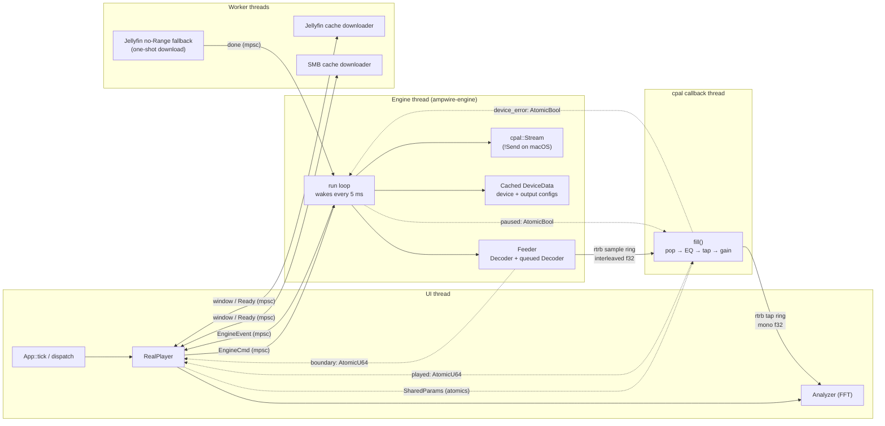
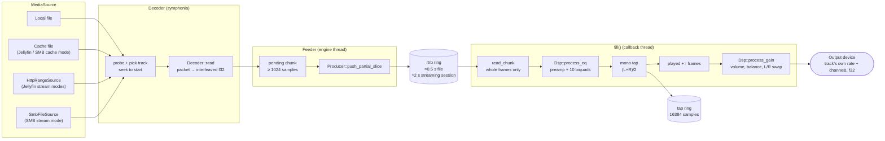
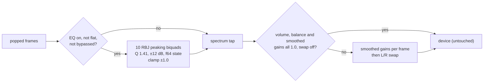
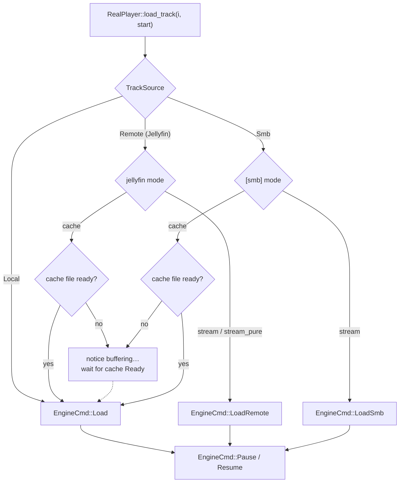
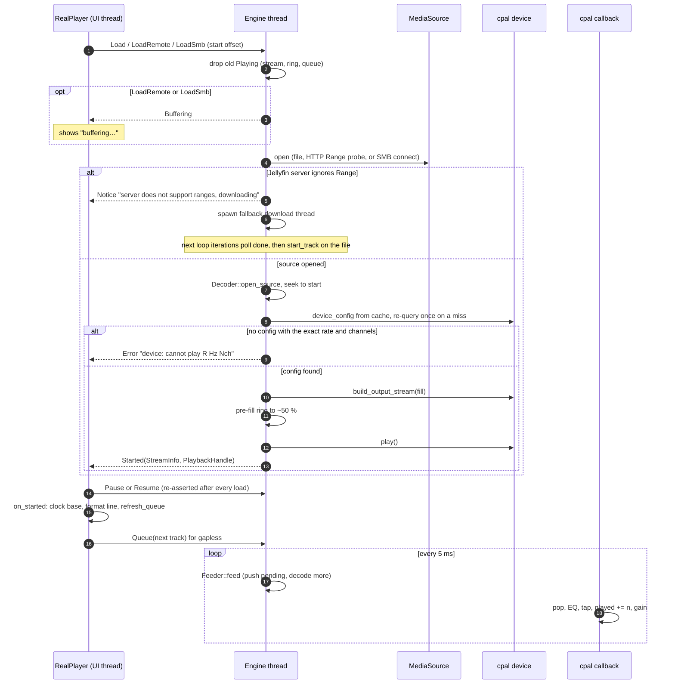
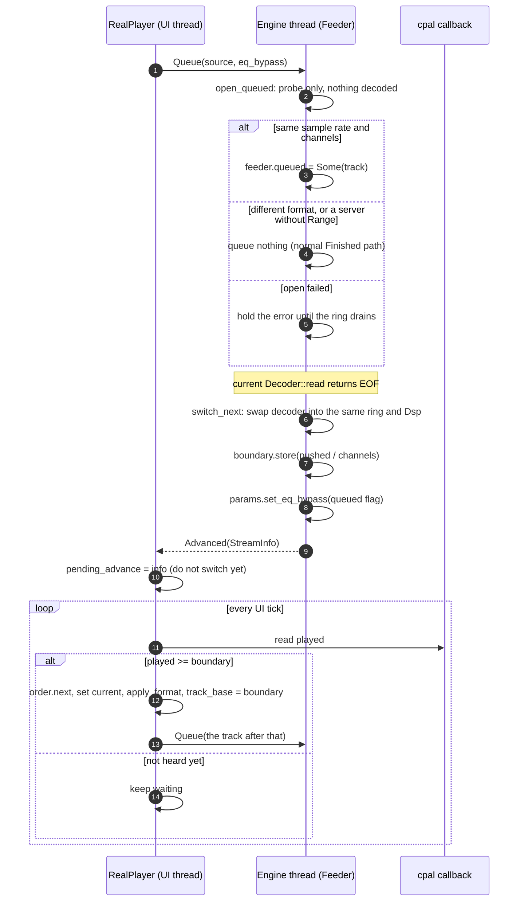
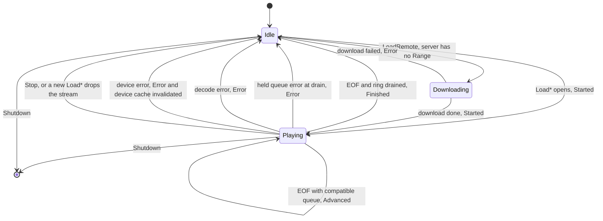

# Audio pipeline architecture

How a track gets from a file, a Jellyfin server or an SMB share to the
output device. The code lives in `src/audio/` (engine, decoder, DSP, EQ,
spectrum analysis) and `src/player/real.rs` (the UI-side state machine that
drives it).

Three rules shape everything below:

- **Never block a frame.** The render loop only reads a `PlayerSnapshot`;
  decode, device and network work happen on other threads.
- **The audio callback is atomics and ring buffers only.** It never
  allocates, locks or touches disk.
- **No resampling, no hidden processing.** The stream opens at the track's
  own rate and channel count, and at unity settings the samples reach the
  device untouched (bit-perfect).

## Threads and channels

| Thread | Owns | Talks through |
|---|---|---|
| UI (`App`, `RealPlayer`) | play order, clock base, `Analyzer`, cache windows | sends `EngineCmd`, polls `EngineEvent` in `RealPlayer::tick`, writes `SharedParams` |
| Engine (`src/audio/engine.rs::run`) | the cpal `Stream`, the current and queued `Decoder`, the ring producer, the device cache, engine-owned credentials (`StreamSetup`, `SmbSetup`) | `mpsc` both ways; feeds the ring every 5 ms; never busy-spins |
| cpal callback (`fill`) | the ring consumer, the tap producer, one `Dsp` per stream | atomics and `rtrb` only |
| Workers | Jellyfin/SMB cache downloads, the no-`Range` fallback download | `mpsc`; polled from `RealPlayer::tick` or the engine loop |

The cpal `Stream` is `!Send` on macOS, so it is created, played and dropped
only on the engine thread. Dropping `Engine` sends `Shutdown` and joins, so
quitting is prompt even mid-playback.

`AudioOut` is the seam between `RealPlayer` and the engine: tests swap in a
fake that records commands and replays events, so `cargo test` never opens a
sound card.

## Sample path

Details that matter:

- **Whole frames only.** `fill` pops `min(buffer frames, ring frames)` whole
  frames in one `read_chunk`. A half frame left by the producer waits in the
  ring, so an underrun can never rotate the channels. The rest of the buffer
  is padded with silence, and padding is never counted, EQ'd, tapped or gained.
- **Pause writes silence without popping**, so the frames-played clock freezes
  by itself. The pause flag lives outside the per-track state and survives a
  `Load`.
- **Pre-fill.** `finish_start` fills the ring to ~50 % before `play()`, so
  playback starts on sound, not silence.
- **Ring size** comes from the track's own format: ≈0.5 s for a file, ≈2 s
  for every track of a session that can stream (Jellyfin `stream*` or
  `[smb] mode = "stream"`), so a network hiccup cannot starve the callback.
- **The tap never blocks.** When the UI falls behind, the tap ring drops
  samples. `RealPlayer::update_spectrum` drains it each tick and feeds the
  newest samples to the FFT on the UI thread.

### DSP chain

The order is fixed: decode → **EQ** → spectrum tap → **volume/balance/swap**
→ device. The bars show the shaped signal, and the gain stage runs last.

The UI never sends DSP changes as commands. It writes targets into
`SharedParams` and the callback picks them up:

| Field | Written by | Read by | Notes |
|---|---|---|---|
| `volume_gain`, `balance_left`, `balance_right` | `SharedParams::set` | `Dsp::process_gain` | `f32::to_bits` in `AtomicU32`; smoothed per frame (`cur += (target - cur) * 0.002`, snap at 1e-4) |
| `swap_channels` | `set_swap_channels` | `Dsp::process_gain` | reorders after the gains, never changes a value |
| `eq_enabled`, `eq_gains[11]` | `set_eq` | `Dsp::process_eq` | published by bumping `eq_version` (Release/Acquire); coefficients are recomputed on a bump |
| `eq_bypass` | `RealPlayer::load_track`; the engine at a gapless boundary | `Dsp::process_eq` | Jellyfin `stream_pure`; re-read every call, no version bump |

The **bit-perfect marker** in the UI uses the same conditions: a lossless,
`f32`-exact source at volume 100, balance 0, no swap and no EQ shaping. It is
Ampwire's own verdict (`bit_perfect_scope: "app"`); PipeWire or Bluetooth can
still resample outside the app.

## Starting a track

`RealPlayer::load_track` picks the command from the track's source and cache
mode. Every engine load is followed by `Pause` or `Resume`, because the
engine's pause flag survives a load (that is how seek-while-paused stays
silent).

On the engine side every load drops the old `Playing` first. Its ring, its
queued next track and its stream go with it, so no stale audio survives.

`PlaybackHandle` is what makes the stream readable from the UI: `played`
(frames really delivered), `boundary` (gapless), `sample_rate`,
`start_offset` (where a seek really landed, packet-rounded) and the tap
consumer. Position = `start_offset + (played - track_base) / sample_rate`.

Seeking is a reload: `RealPlayer::seek_to` sends a new `Load*` at the target
offset. A container that refuses to seek returns `PlayError::SeekUnsupported`,
and the player restarts the track from 0 instead of skipping it.

## Gapless playback

After every `Started` and every boundary crossing, `RealPlayer` queues
`order.upcoming(1)`. It re-sends the queue, or `Unqueue`s, on every order
change. End of order, a repeat wrap and a stopped player queue nothing.

The UI moves the cursor only when `played` crosses `boundary`, never when
`Advanced` arrives. The event can arrive up to one ring length (0.5–2 s)
before the first sample of the new track is heard.

## How a track ends

What `RealPlayer::tick` does with each event:

| Event | UI reaction |
|---|---|
| `Started` | takes the new handle, resets the clock base, updates the format line, sends the gapless `Queue` |
| `Advanced` | stores `pending_advance`; `check_boundary` switches tracks once the audio gets there |
| `Finished` | auto-advance: loads the next track through a new stream (the "gap" path) |
| `Error(PlayError)` | `SeekUnsupported` restarts at 0; `Failed(reason)` skips, and stops when the failures span the whole list |
| `Buffering` / `Notice` | shown on the notice line |

## Where to look

| Concern | File |
|---|---|
| Engine loop, `EngineCmd`/`EngineEvent`, `Feeder`, `fill`, ring sizing, device cache | `src/audio/engine.rs` |
| symphonia probe/seek/decode, `StreamInfo`, `PlayError` | `src/audio/decoder.rs` |
| `SharedParams`, `Dsp` (EQ gate, gain smoothing, swap) | `src/audio/dsp.rs` |
| Biquad math | `src/audio/eq.rs` |
| FFT over the tap | `src/audio/analysis.rs` |
| Load routing, event handling, gapless boundary, bit-perfect marker | `src/player/real.rs` |
| Seekable remote sources | `src/jellyfin/http_source.rs`, `src/smb/source.rs` |
| Rolling download windows | `src/jellyfin/cache.rs`, `src/smb/cache.rs` |
